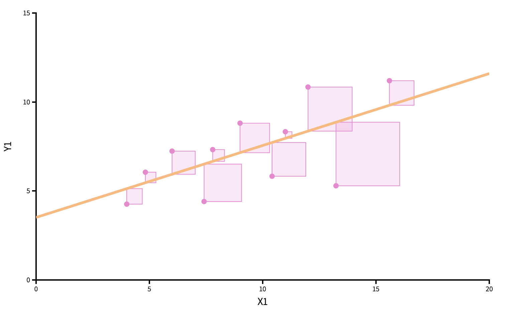

```{r}
#| label: load-packages
#| message: false
#| echo: false
library(tidyverse)
library(tidymodels)
library(openintro)
library(distr)
library(glue)
todays_ae <- "ae-24-card-krueger"
```


# Recap: statistical inference

## The bottom line, at the top

- Data science is the messy, real-world *art* of converting data into knowledge;
- Statistics is the mathematical study of quantifying uncertainty about that knowledge to help guide decision-making.

## The population model (greek letters, no hats) {.scrollable}

::: incremental
-   This is an *idealized* representation of the data: $$
    y = \beta_0+\beta_1x +\varepsilon;
    $$

-   There is some "true line" floating out there with a "true slope" $\beta_1$ and "true intercept" $\beta_0$;

-   With infinite amounts of perfectly measured data, we could know $\beta_0$ and $\beta_1$ exactly;

-   We don't have that, so we must use finite amounts of imperfect data to *estimate*;

-   We are especially interested in $\beta_1$ because is characterizes the association between $x$ and $y$, which is useful for *prediction*.
:::

## "Three branches of statistical government" {.scrollable}

$\beta_1$ is an unknown quantity we are trying to learn about using noisy, imperfect data. Learning comes in three flavors:

::: incremental
-   **POINT ESTIMATION**: get a single-number best guess for $\beta_1$;

-   **INTERVAL ESTIMATION**: get a range of likely values for $\beta_1$ that characterizes (sampling) uncertainty;

-   **HYPOTHESIS TESTING**: use the data to distinguish competing claims about $\beta_1$.
:::

## Point estimation (roman letters, hats!) {.scrollable}

We estimate $\beta_0$ and $\beta_1$ with the coefficients of the best fit line:

$$
\hat{y}=b_0+b_1x.
$$

"Best" means "least squares." We pick the estimates so that the sum of squared residuals is as small as possible. [Play around!](https://seeing-theory.brown.edu/regression-analysis/index.html)

{width="50%" fig-align="center"} 

## Point estimation {.scrollable}

```{r}
ggplot(mtcars, aes(x = wt, y = mpg)) + 
  geom_point() +
  geom_smooth(method = "lm")
```


## Point estimation {.scrollable}

```{r}
linear_reg() |>
  fit(mpg ~ wt, data = mtcars) |>
  tidy()
```


## Sampling uncertainty {.scrollable}

::: incremental
- How do our point estimates vary across alternative, hypothetical datasets?

    - If they vary alot, uncertainty is high, and results are unreliable;
    - if they vary only a little, uncertainty is low, and results are more reliable.
    
- We can use the *bootstrap* to construct alternative datasets and assess the sensitivity of our estimates to changes in the data.
:::

## Bootstrap distribution {.medium .scrollable}

This histogram displays variation in the slope estimate across alternative datasets. 

- Large spread >> high uncertainty;
- Small spread >> lower uncertainty.


```{r}
#| echo: false

df_fit <- linear_reg() |>
  fit(price ~ area, data = duke_forest)

intercept <- tidy(df_fit) |> filter(term == "(Intercept)") |> pull(estimate) |> round()
slope <- tidy(df_fit) |> filter(term == "area") |> pull(estimate) |> round()

set.seed(119)

df_boot_samples_100 <- duke_forest |>
  specify(price ~ area) |>
  generate(reps = 100, type = "bootstrap")

df_boot_samples_100_fit <- df_boot_samples_100 |>
  fit()

df_boot_samples_100_hist <- ggplot(df_boot_samples_100_fit |> filter(term == "area"), aes(x = estimate)) +
  geom_histogram(binwidth = 10, color = "white") +
  geom_vline(xintercept = slope, color = "#8F2D56", linewidth = 1) +
  labs(x = "Slope", y = "Count",
       title = "Slopes of 100 bootstrap samples") +
  scale_x_continuous(labels = label_dollar())

df_boot_samples_100_hist
```

## Confidence interval {.scrollable}

Pick a range that swallows up a large % of the histogram:

```{r}
#| echo: false
lower <- df_boot_samples_100_fit |>
  ungroup() |>
  filter(term == "area") |>
  summarise(quantile(estimate, 0.025)) |>
  pull()

upper <- df_boot_samples_100_fit |>
  ungroup() |>
  filter(term == "area") |>
  summarise(quantile(estimate, 0.975)) |>
  pull()

df_boot_samples_100_hist +
  geom_vline(xintercept = lower, color = "steelblue", linewidth = 1, linetype = "dashed") +
  geom_vline(xintercept = upper, color = "steelblue", linewidth = 1, linetype = "dashed")
```

We use quantiles (think IQR) but there are other ways.

## Hypothesis testing {.scrollable}

::: incremental
- Two competing claims about $\beta_1$:
$$
\begin{aligned}
H_0&: \beta_1=0\quad(\text{nothing going on})\\
H_A&: \beta_1\neq0\quad(\text{something going on})
\end{aligned}
$$

- In words: "are x and y correlated or not?"

- Do the data strongly favor one or the other? 

- How can we quantify this?
:::

## Hypothesis testing {.scrollable}

::: incremental 
- Think hypothetically: if the null hypothesis were in fact true, would my results be out of the ordinary?

    - if no, then the null could be true;
    - if yes, then the null might be bogus;

- My results represent the reality of actual data. If they conflict with the null, then you throw out the null and stick with reality;

- How do we *quantify* "would my results be out of the ordinary"?
:::

## Null distribution {.medium .scrollable}

If the null happened to be true, how would we expect our results to vary across datasets? We can use simulation to answer this:

```{r}
#| echo: false
#| message: false
#| warning: false

set.seed(34)
fake_draws <- tibble(
  replicate = 1:500,
  x = rnorm(500),
  stat = x,
  estimate = x,
) 

fake_draws |>
  ggplot(aes(x = x)) + 
  geom_histogram() + 
  labs(
    title = "Null distribution: variation in the slope estimate if the null were true",
    x = "hypothetical slope estimates",
    y = "count"
  ) + 
  xlim(-5, 5)
```


This is how the world should look *if the null is true*. 

## Null distribution versus reality {.medium .scrollable}

Locate the *actual* results of your *actual* data analysis under the null distribution. Are they in the middle? Are they in the tails?

```{r}
#| echo: false
#| message: false
#| warning: false
#| fig-asp: 0.4

fake_draws |>
  ggplot(aes(x = x)) + 
  geom_histogram() + 
  geom_vline(xintercept = 0.5, color = "red", size = 2) + 
  annotate("text", x = 2, y = 65, label = "Your actual\nslope estimate", color = "red", size = 3*.pt) + 
  labs(
    title = "Null distribution: variation in the slope estimate if the null were true",
    x = "hypothetical slope estimates",
    y = "count"
  ) + 
  xlim(-5, 5)
```

Are these results in harmony or conflict with the null?

## Null distribution versus reality {.medium .scrollable}

Locate the *actual* results of your *actual* data analysis under the null distribution. Are they in the middle? Are they in the tails?

```{r}
#| echo: false
#| message: false
#| warning: false
#| fig-asp: 0.4

fake_draws |>
  ggplot(aes(x = x)) + 
  geom_histogram() + 
  geom_vline(xintercept = 5, color = "red", size = 2) + 
  annotate("text", x = 3.5, y = 65, label = "Your actual\nslope estimate", color = "red", size = 3*.pt) + 
  labs(
    title = "Null distribution: variation in the slope estimate if the null were true",
    x = "hypothetical slope estimates",
    y = "count"
  ) + 
  xlim(-5, 5)
```

Are these results in harmony or conflict with the null?


## Null distribution versus reality {.medium .scrollable}

Locate the *actual* results of your *actual* data analysis under the null distribution. Are they in the middle? Are they in the tails?

```{r}
#| echo: false
#| message: false
#| warning: false
#| fig-asp: 0.4

fake_draws |>
  ggplot(aes(x = x)) + 
  geom_histogram() + 
  geom_vline(xintercept = 1.75, color = "red", size = 2) + 
  annotate("text", x = 3.5, y = 65, label = "Your actual\nslope estimate", color = "red", size = 3*.pt) + 
  labs(
    title = "Null distribution: variation in the slope estimate if the null were true",
    x = "hypothetical slope estimates",
    y = "count"
  ) + 
  xlim(-5, 5)
```

Are these results in harmony or conflict with the null?

## The main idea

- The point estimate is *reality*. That's what the data say;
- The null distribution is *hypothetical*;
- Are the reality and the hypothetical in harmony or conflict?
  - If harmony, the null remains plausible and cannot be dismissed;
  - If conflict, go with reality (reject the null).
- Instead of eyeballing a picture, how can we *quantity* the degree of "harmoniousness" between reality and the hypothetical?
  
  
## *p*-value {.scrollable}

::: incremental
The $p$-value is the probability of being *even farther out* in the tails of the null distribution than your results already were. 

- if this number is very low, then your results would be out of the ordinary if the null were true, so maybe the null was never true to begin with;

- if this number is high, then your results may be perfectly compatible with the null.
:::

## *p*-value {.scrollable}

*p*-value is the fraction of the histogram area shaded red:

```{r}
#| echo: false
#| message: false
#| warning: false
set.seed(3)
x <- rnorm(100, mean = 0.1, sd = 2)
df <- tibble(x = x)
obs_stat <- df |>
  specify(response = x) |>
  calculate(stat = "mean")
null_dist <- df |>
  specify(response = x) |>
  hypothesize(null = "point", mu = 0) |>
  generate(reps = 1000, type = "bootstrap") |>
  calculate(stat = "mean")


visualize(null_dist) + 
  shade_p_value(obs_stat = obs_stat, direction = "two-sided")
```

. . .

Big ol' *p*-value. Null remains plausible

## *p*-value {.scrollable}

*p*-value is the fraction of the histogram area shaded red:

```{r}
#| echo: false
#| message: false
#| warning: false
set.seed(3)
x <- rnorm(100, mean = 1, sd = 2)
df <- tibble(x = x)
obs_stat <- df |>
  specify(response = x) |>
  calculate(stat = "mean")
null_dist <- df |>
  specify(response = x) |>
  hypothesize(null = "point", mu = 0) |>
  generate(reps = 1000, type = "bootstrap") |>
  calculate(stat = "mean")


visualize(null_dist) + 
  shade_p_value(obs_stat = obs_stat, direction = "two-sided")
```

. . .

*p*-value is basically zero. Null looks bogus.

## *p*-value {.scrollable}

*p*-value is the fraction of the histogram area shaded red:

```{r}
#| echo: false
#| message: false
#| warning: false
set.seed(3)
x <- rnorm(100, mean = 0.5, sd = 4)
df <- tibble(x = x)
obs_stat <- df |>
  specify(response = x) |>
  calculate(stat = "mean")
null_dist <- df |>
  specify(response = x) |>
  hypothesize(null = "point", mu = 0) |>
  generate(reps = 1000, type = "bootstrap") |>
  calculate(stat = "mean")


visualize(null_dist) + 
  shade_p_value(obs_stat = obs_stat, direction = "two-sided")
```

. . .

*p*-value is...kinda small? Null looks...?

## Discernibility level {.scrollable}

::: incremental 
- How do we decide if the *p*-value is big enough or small enough?

- Pick a threshold $\alpha\in[0,\,1]$ called the *discernibility level*:
  -   If $p\text{-value} < \alpha$, reject null and accept alternative;
  -   If $p\text{-value} \geq \alpha$, fail to reject null;
  
- Standard choices: $\alpha=0.01, 0.05, 0.1, 0.15$.
:::


